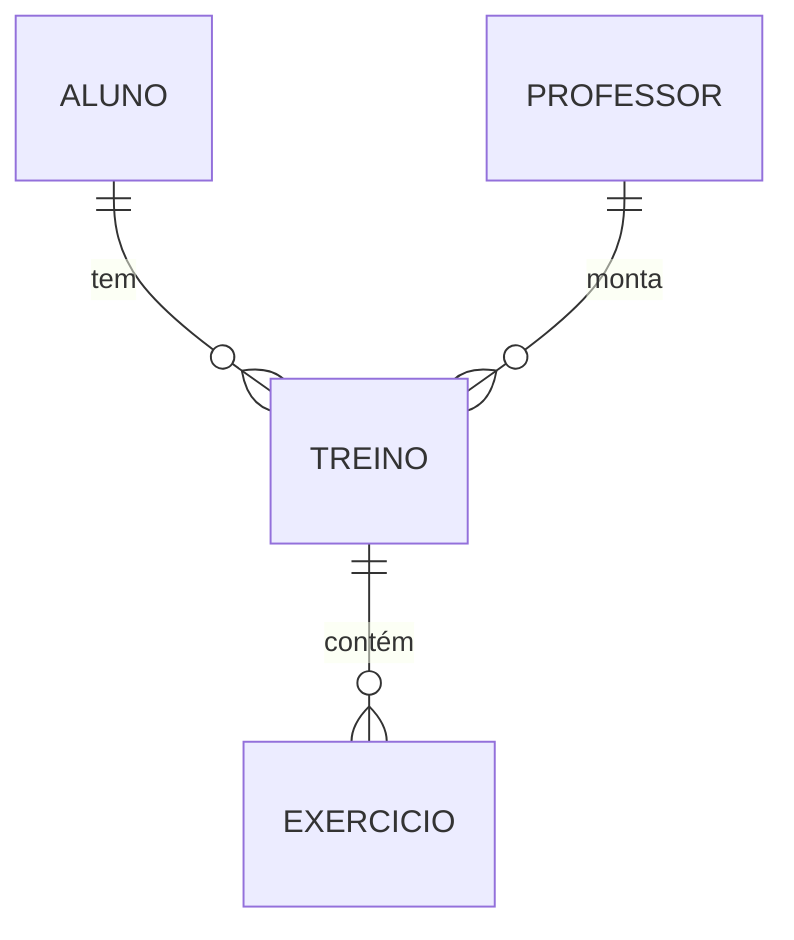

# LegalFit Academia — Sistema da Recepção

Sistema web para a recepção de uma academia cadastrar **alunos**, **professores**, **treinos**
e **exercícios**, feito com **Spring Boot** seguindo o tutorial da disciplina
"Spring Boot na Prática – Marca e Carro".

Tudo fica num projeto só: o **backend** (Java + Spring) e o **frontend** (páginas HTML com
Thymeleaf), exatamente como no tutorial.

---

## Tecnologias (as mesmas do tutorial)

| Tecnologia | Para que serve |
|---|---|
| Spring Web | Controllers e rotas |
| Spring Data JPA | Acesso ao banco de dados |
| H2 Database | Banco em memória (os dados somem quando a aplicação para) |
| Thymeleaf | Motor de templates das páginas HTML |
| Bean Validation | Validação dos campos com anotações |

Versões: Java 17+ e Spring Boot 4.1.2.

---

## Como rodar

**Pelo Eclipse:** botão direito em `LegalFitAcademiaApplication.java` → **Run As → Java Application**.

**Pelo terminal (Mac)**, na pasta do projeto:

```bash
./mvnw spring-boot:run
```

Depois acesse:

| Endereço | O que é |
|---|---|
| http://localhost:8081 | Página inicial da recepção |
| http://localhost:8081/alunos | Gerenciar alunos |
| http://localhost:8081/professores | Gerenciar professores |
| http://localhost:8081/treinos | Gerenciar treinos |
| http://localhost:8081/exercicios | Gerenciar exercícios |
| http://localhost:8081/h2-console | Console do banco (JDBC URL `jdbc:h2:mem:academiadb`, usuário `sa`, senha em branco) |

> A porta é **8081** porque a 8080 estava ocupada nos computadores da faculdade.

---

## Estrutura de pacotes

```
com.fametro.academia
├── LegalFitAcademiaApplication.java
├── controller
│   ├── AlunoController.java
│   ├── ProfessorController.java
│   ├── TreinoController.java
│   └── ExercicioController.java
├── model
│   ├── Aluno.java
│   ├── Professor.java
│   ├── Treino.java
│   └── Exercicio.java
└── repository
    ├── AlunoRepository.java
    ├── ProfessorRepository.java
    ├── TreinoRepository.java
    └── ExercicioRepository.java

src/main/resources
├── application.properties
├── templates
│   ├── alunos/        listar.html, formulario.html
│   ├── professores/   listar.html, formulario.html
│   ├── treinos/       listar.html, formulario.html
│   └── exercicios/    listar.html, formulario.html
└── static
    ├── index.html     (página inicial da recepção)
    └── css/estilo.css
```

- **model**: as entidades JPA. Cada classe com `@Entity` vira uma tabela no banco.
- **repository**: interfaces que estendem `CrudRepository`. O Spring cria sozinho os métodos
  `findAll`, `findById`, `save` e `delete`.
- **controller**: recebem as requisições, usam os repositórios e devolvem o nome da página
  Thymeleaf que deve ser mostrada.
- **templates**: as páginas HTML. Cada tabela tem uma página de listagem e um formulário, que
  serve tanto para cadastrar quanto para editar.

---

## Tabelas e relacionamentos



| Tabela | Campos | Validações |
|---|---|---|
| **aluno** | id, nome, email, idade | nome obrigatório; e-mail obrigatório, válido e único; idade positiva |
| **professor** | id, nome, cref, especialidade | todos obrigatórios; CREF único |
| **treino** | id, nome, objetivo, aluno_id, professor_id | nome e objetivo obrigatórios; aluno e professor obrigatórios |
| **exercicio** | id, nome, series, repeticoes, carga, treino_id | nome obrigatório; séries e repetições positivas; carga maior ou igual a zero; treino obrigatório |

- Um **aluno** tem vários **treinos** (`@OneToMany` em Aluno, `@ManyToOne` em Treino).
- Um **professor** monta vários **treinos** (`@OneToMany` em Professor, `@ManyToOne` em Treino).
- Um **treino** tem vários **exercícios** (`@OneToMany` em Treino, `@ManyToOne` em Exercicio).

No formulário de treino, a recepção escolhe o aluno e o professor num `<select>`. No formulário
de exercício, escolhe o treino. É o mesmo jeito que o tutorial escolhe a marca do carro.

**Exclusão em cascata:** excluir um aluno ou um professor exclui os treinos dele, e excluir
um treino exclui os exercícios dele.

---

## Ordem de cadastro na recepção

1. Cadastre o **professor** e o **aluno**.
2. Crie o **treino**, escolhendo o aluno e o professor.
3. Adicione os **exercícios** do treino.

---

## Rotas

Cada tabela tem as mesmas rotas do tutorial (exemplo com `alunos`; vale igual para
`professores`, `treinos` e `exercicios`):

| Método | Rota | Descrição |
|---|---|---|
| GET | `/alunos` | Lista todos os alunos |
| GET | `/alunos/novo` | Formulário de novo aluno |
| POST | `/alunos/salvar` | Salva um aluno (novo ou editado) |
| GET | `/alunos/editar/{id}` | Formulário de edição |
| GET | `/alunos/excluir/{id}` | Exclui um aluno |

---

## Ajustes em relação ao tutorial

O código segue o tutorial, com quatro correções necessárias para funcionar:

1. **`jakarta.*` em vez de `javax.*`**: o Spring Boot 3 em diante usa os pacotes `jakarta`.
   Com `javax`, o código não compila.
2. **`cascade = CascadeType.REMOVE`** em vez de `CascadeType.ALL, orphanRemoval = true`: com a
   versão do tutorial, editar um professor pelo formulário apagava todos os treinos dele. O
   formulário devolve a lista de treinos vazia, e o `orphanRemoval` entende isso como "apague
   os treinos".
3. **`th:value="${a.id}"` nos `<select>`** em vez de `th:value="${m}"`: com o objeto inteiro, o
   valor enviado é um texto como `Aluno@1a2b`, e o Spring não consegue convertê-lo de volta. Com
   o id, ele busca o registro sozinho, e na edição o item já vem selecionado.
4. **`@NotNull` nos relacionamentos**: sem ele, salvar com "Selecione..." escolhido gerava uma
   página de erro em vez de uma mensagem no formulário.

## Limitações

- O banco H2 é **em memória**: ao parar a aplicação, os dados somem.
- Cadastrar um e-mail ou CREF que já existe mostra uma página de erro, porque o banco recusa
  valores repetidos (o tutorial tem o mesmo comportamento com o nome da marca).
