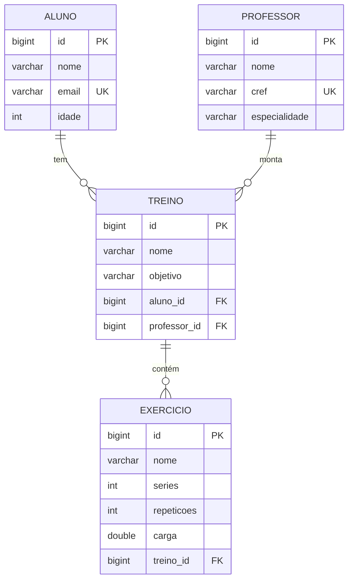

# LegalFit Academia — Backend

Sistema de gerenciamento de academia feito com **Spring Boot**, como tarefa da disciplina
(seguindo o tutorial "Spring Boot na Prática – Marca e Carro").

O projeto funciona de **duas formas ao mesmo tempo**:

1. **Site com telas prontas** (Thymeleaf) em `http://localhost:8081` — é a parte da tarefa.
2. **API REST** em `http://localhost:8081/api/...` — devolve JSON, para ser usada por um
   frontend separado (React, por exemplo).

As duas formas usam o mesmo banco de dados e as mesmas entidades.

---

## Tecnologias

| Tecnologia | Para que serve |
|---|---|
| Java 17+ | Linguagem |
| Spring Boot 4.1.2 | Framework que monta e roda a aplicação |
| Spring Web MVC | Recebe as requisições HTTP (telas e API) |
| Spring Data JPA + Hibernate | Salva e busca os dados no banco sem escrever SQL |
| H2 Database | Banco de dados em memória (os dados somem quando a aplicação para) |
| Thymeleaf | Monta as páginas HTML no servidor |
| Bean Validation | Valida os campos com anotações (`@NotBlank`, `@Positive`...) |
| Maven | Baixa as dependências e compila o projeto |

---

## Como rodar

**Pelo Eclipse:** botão direito em `LegalFitAcademiaApplication.java` → **Run As → Java Application**.

**Pelo terminal (Mac)**, na pasta do projeto:

```bash
./mvnw spring-boot:run
```

> Se aparecer "Unable to locate a Java Runtime", rode com o Java do Homebrew:
> `JAVA_HOME=/opt/homebrew/opt/openjdk@21 ./mvnw spring-boot:run`
>
> Se aparecer "Port 8081 was already in use", a aplicação já está rodando em outro lugar
> (por exemplo, no Eclipse). Pare a outra antes.

Depois abra:

| Endereço | O que é |
|---|---|
| http://localhost:8081 | Página inicial com links para as telas |
| http://localhost:8081/api/alunos | Exemplo de chamada da API (JSON) |
| http://localhost:8081/h2-console | Console do banco (JDBC URL: `jdbc:h2:mem:academiadb`, usuário `sa`, senha em branco) |

---

## Estrutura de pastas

```
src/main/java/com/fametro/academia/
├── LegalFitAcademiaApplication.java   → classe principal (tem o main)
├── model/                             → entidades = tabelas do banco
│   ├── Aluno.java
│   ├── Professor.java
│   ├── Treino.java
│   └── Exercicio.java
├── repository/                        → acesso ao banco (Spring Data)
│   ├── AlunoRepository.java
│   ├── ProfessorRepository.java
│   ├── TreinoRepository.java
│   └── ExercicioRepository.java
├── controller/                        → controllers das TELAS (devolvem HTML)
│   ├── AlunoController.java
│   ├── ProfessorController.java
│   ├── TreinoController.java
│   ├── ExercicioController.java
│   └── api/                           → controllers da API (devolvem JSON)
│       ├── AlunoApiController.java
│       ├── ProfessorApiController.java
│       ├── TreinoApiController.java
│       ├── ExercicioApiController.java
│       └── ApiExceptionHandler.java   → transforma erros da API em JSON
└── config/
    └── CorsConfig.java                → libera o frontend React a chamar a API

src/main/resources/
├── application.properties             → configuração do banco, porta etc.
├── templates/                         → páginas Thymeleaf (listar.html e formulario.html de cada tabela)
└── static/                            → arquivos fixos: index.html e css/estilo.css
```

### Como as camadas conversam

```
Navegador / React
      │  requisição HTTP
      ▼
Controller  ──usa──►  Repository  ──usa──►  Banco H2
      │                                    (tabelas criadas a partir do model)
      ▼
HTML (telas)  ou  JSON (API)
```

- **model**: cada classe com `@Entity` vira uma tabela. Os atributos viram colunas.
- **repository**: interfaces que estendem `CrudRepository`. O Spring cria sozinho os métodos
  `findAll`, `findById`, `save` e `delete`.
- **controller**: recebe a requisição, usa o repository e devolve uma página (`@Controller`)
  ou JSON (`@RestController`).

---

## Modelo de dados



| Tabela | Campos | Regras de validação |
|---|---|---|
| **aluno** | id, nome, email, idade | nome obrigatório; e-mail obrigatório, válido e **único**; idade positiva |
| **professor** | id, nome, cref, especialidade | todos obrigatórios; CREF **único** |
| **treino** | id, nome, objetivo, aluno_id, professor_id | nome e objetivo obrigatórios; aluno e professor obrigatórios |
| **exercicio** | id, nome, series, repeticoes, carga, treino_id | nome obrigatório; séries e repetições positivas; carga ≥ 0; treino obrigatório |

### Relacionamentos

- Um **aluno** tem vários **treinos** → `@OneToMany` em `Aluno` / `@ManyToOne` em `Treino`.
- Um **professor** monta vários **treinos** → `@OneToMany` em `Professor` / `@ManyToOne` em `Treino`.
- Um **treino** tem vários **exercícios** → `@OneToMany` em `Treino` / `@ManyToOne` em `Exercicio`.

**Exclusão em cascata** (`cascade = CascadeType.REMOVE`):

- Excluir um **aluno** exclui os treinos dele (e os exercícios desses treinos).
- Excluir um **professor** exclui os treinos que ele montou (e os exercícios).
- Excluir um **treino** exclui os exercícios dele.

---

## Telas (Thymeleaf)

Cada tabela tem as mesmas 5 rotas (exemplo com `alunos`; troque por `professores`,
`treinos` ou `exercicios`):

| Método | Rota | O que faz |
|---|---|---|
| GET | `/alunos` | Lista todos |
| GET | `/alunos/novo` | Formulário vazio |
| POST | `/alunos/salvar` | Salva (novo ou edição) |
| GET | `/alunos/editar/{id}` | Formulário preenchido |
| GET | `/alunos/excluir/{id}` | Exclui |

---

## API REST

Base: `http://localhost:8081/api`

Todas as tabelas seguem o mesmo padrão (troque `alunos` por `professores`, `treinos` ou `exercicios`):

| Método | Rota | O que faz | Resposta de sucesso |
|---|---|---|---|
| GET | `/api/alunos` | Lista todos | `200` + lista em JSON |
| GET | `/api/alunos/{id}` | Busca um | `200` + objeto |
| POST | `/api/alunos` | Cria | `201` + objeto criado (com id) |
| PUT | `/api/alunos/{id}` | Atualiza | `200` + objeto atualizado |
| DELETE | `/api/alunos/{id}` | Exclui | `204` (sem corpo) |

### Exemplos de JSON

**Professor** — `POST /api/professores`
```json
{ "nome": "Carla Souza", "cref": "012345-G/AM", "especialidade": "Musculação" }
```

**Aluno** — `POST /api/alunos`
```json
{ "nome": "João Silva", "email": "joao@email.com", "idade": 20 }
```

**Treino** — `POST /api/treinos` (manda só o **id** do aluno e do professor)
```json
{ "nome": "Treino A", "objetivo": "Hipertrofia", "aluno": { "id": 1 }, "professor": { "id": 1 } }
```

**Exercício** — `POST /api/exercicios` (manda só o **id** do treino)
```json
{ "nome": "Supino reto", "series": 4, "repeticoes": 12, "carga": 20, "treino": { "id": 1 } }
```

Na **resposta**, o treino e o exercício vêm com os objetos completos dentro. Exemplo de `GET /api/treinos`:

```json
[
  {
    "id": 1,
    "nome": "Treino A",
    "objetivo": "Hipertrofia",
    "aluno": { "id": 1, "nome": "João Silva", "email": "joao@email.com", "idade": 20 },
    "professor": { "id": 1, "nome": "Carla Souza", "cref": "012345-G/AM", "especialidade": "Musculação" }
  }
]
```

> As listas (`treinos` do aluno, `exercicios` do treino...) **não** aparecem no JSON por causa do
> `@JsonIgnore`. Sem ele, o JSON entraria em loop infinito: aluno → treinos → aluno → treinos...
> Para ver os exercícios de um treino, o front busca `/api/exercicios` e filtra pelo `treino.id`.

### Erros

| Situação | Código | Corpo da resposta |
|---|---|---|
| Campo inválido | `400` | `{"nome": "O nome do aluno é obrigatório", "idade": "A idade deve ser positiva"}` |
| Aluno/professor/treino informado não existe | `400` | `{"erro": "Aluno não encontrado: 99"}` |
| Id não existe (GET/PUT/DELETE) | `404` | `{"erro": "Aluno não encontrado: 99"}` |
| E-mail ou CREF repetido | `409` | `{"erro": "Já existe um cadastro com esse valor (e-mail ou CREF repetido)"}` |

No erro `400` de validação, cada chave é o nome do campo. Assim o front consegue mostrar a
mensagem embaixo do campo certo.

---

## Guia para o projeto de frontend (React)

1. **Deixe este backend rodando** (porta 8081).
2. Crie o projeto React em **outra pasta** (fora deste projeto). Com o Vite:
   ```bash
   npm create vite@latest legalfit-front -- --template react
   cd legalfit-front
   npm install
   npm run dev
   ```
   Isso precisa do **Node.js** instalado (`brew install node`). O React vai rodar em
   `http://localhost:5173`.
3. **CORS já está liberado** para `http://localhost:5173` (Vite) e `http://localhost:3000`
   (Create React App) em `config/CorsConfig.java`. Se o front usar outra porta, adicione-a lá.
   Sem isso, o navegador bloqueia as chamadas com um erro de "CORS policy".

Exemplos de chamadas com `fetch`:

```js
const API = "http://localhost:8081/api";

// Listar
const resposta = await fetch(`${API}/alunos`);
const alunos = await resposta.json();

// Criar
const r = await fetch(`${API}/alunos`, {
  method: "POST",
  headers: { "Content-Type": "application/json" },
  body: JSON.stringify({ nome: "Maria", email: "maria@email.com", idade: 25 }),
});
if (r.status === 400) {
  const erros = await r.json(); // { email: "Digite um e-mail válido", ... }
}

// Atualizar
await fetch(`${API}/alunos/1`, {
  method: "PUT",
  headers: { "Content-Type": "application/json" },
  body: JSON.stringify({ nome: "Maria Lima", email: "maria@email.com", idade: 26 }),
});

// Excluir
await fetch(`${API}/alunos/1`, { method: "DELETE" });
```

Ordem sugerida para montar as telas no React: **Professores → Alunos → Treinos → Exercícios**.
Os dois primeiros não dependem de ninguém. Treino precisa de alunos e professores cadastrados,
e Exercício precisa de treinos.

---

## Decisões importantes (e diferenças em relação ao tutorial)

- **`jakarta.*` em vez de `javax.*`**: o tutorial usa `javax.persistence` e `javax.validation`,
  que não existem mais no Spring Boot 3/4.
- **`CascadeType.REMOVE` em vez de `CascadeType.ALL, orphanRemoval = true`**: com o padrão do
  tutorial, editar um professor pelo formulário apagava todos os treinos dele. O formulário
  devolve a lista de treinos vazia, e o `orphanRemoval` entende isso como "apague os treinos".
  Isso foi testado.
- **`<select>` com `th:value="${x.id}"`**: o tutorial usa `th:value="${m}"`, que gera um texto
  como `Marca@1a2b` que o Spring não consegue converter de volta. Com o id, o Spring Data busca a
  entidade sozinho, e na edição o item já vem selecionado.
- **`@NotNull` nos relacionamentos**: sem ele, deixar "Selecione..." escolhido gerava erro 500
  em vez de uma mensagem.
- **No `PUT` da API**, o controller busca o registro no banco e copia os campos novos, em vez de
  salvar o objeto que veio no JSON. Assim nunca se perde nenhum relacionamento.

## Limitações conhecidas e próximos passos

- O banco **H2 é em memória**: ao parar a aplicação, todos os dados somem. Para guardar de
  verdade, troque por MySQL ou PostgreSQL (muda só o `pom.xml` e o `application.properties`).
- Nas **telas Thymeleaf**, e-mail ou CREF repetido ainda mostra uma página de erro (na API já
  vem o `409` tratado).
- A API devolve as próprias entidades. Em projetos maiores é comum criar **DTOs** (classes só
  para entrada e saída de dados).
- Não há login nem autenticação (seria o Spring Security).
